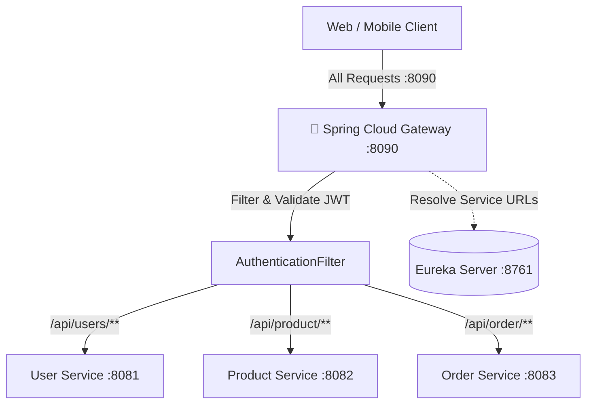

# 🚪 API Gateway Service — ChaloKharido Microservices Platform

[](https://www.oracle.com/java/)
[](https://spring.io/projects/spring-boot)
[](https://spring.io/projects/spring-cloud-gateway)
[](https://cloud.spring.io/spring-cloud-netflix/reference/html/)
[](https://www.docker.com/)

Centralized **API Gateway & Reverse Proxy** for the **ChaloKharido** e-commerce microservices platform. Built with **Spring Cloud Gateway**, acting as the single entry point for all frontend, mobile, and external API traffic on port `8090`.

---

## 🌟 Key Architectural Responsibilities

- **Centralized Entry Point (Port 8090)**: Eliminates direct client exposure to internal microservices, enforcing unified routing and security.
- **Dynamic Service Routing & Load Balancing**: Discovers target services dynamically via Netflix Eureka using `lb://<service-name>` with client-side load balancing.
- **Authentication & JWT Validation (`AuthenticationFilter`)**: Intercepts inbound requests, validates stateless JWT tokens, verifies signatures, and blocks unauthorized requests before reaching downstream services.
- **User Identity Propagation**: Unpacks verified JWT claims and injects downstream headers:
  - `X-User-Id`
  - `X-User-Role`
  - `X-User-Email`  
  *(Downstream services never need to re-parse or verify JWTs).*
- **Global CORS Management**: Unified Cross-Origin Resource Sharing handling for React/Angular web clients across all HTTP methods (`GET`, `POST`, `PUT`, `DELETE`, `OPTIONS`).

---

## 🏗️ Routing Architecture



---

## 🛣️ Configured Routes

| Route ID | Path Predicate | Target URI | Description |
| :--- | :--- | :--- | :--- |
| `user-service-route` | `/api/user/**`, `/api/users/**` | `lb://user-service` | Auth, Registration, Profiles |
| `product-service-route` | `/api/product/**` | `lb://product-service` | Products catalog & inventory |
| `order-service-route` | `/api/order/**` | `lb://order-service` | Order placement & tracking |

---

## ⚙️ Configuration

Configured via `application.yml`:

```yaml
server:
  port: 8090

spring:
  application:
    name: api-gateway
  cloud:
    gateway:
      discovery:
        locator:
          enabled: true
          lower-case-service-id: true
      globalcors:
        cors-configurations:
          '[/**]':
            allowedOrigins: "*"
            allowedMethods: [GET, POST, PUT, DELETE, OPTIONS]
            allowedHeaders: "*"
      default-filters:
        - AuthenticationFilter
      routes:
        - id: user-service-route
          uri: lb://user-service
          predicates:
            - Path=/api/user/**, /api/users/**
        - id: product-service-route
          uri: lb://product-service
          predicates:
            - Path=/api/product/**
        - id: order-service-route
          uri: lb://order-service
          predicates:
            - Path=/api/order/**

eureka:
  client:
    service-url:
      defaultZone: http://localhost:8761/eureka/
```

---

## 🚀 Running Locally

```bash
# Run with Maven Wrapper
./mvnw clean spring-boot:run
```
*(On Windows: `mvnw.cmd spring-boot:run`)*

The Gateway will be available at **`http://localhost:8090`**.

---

## 🐳 Docker Deployment

```bash
# Build the JAR
./mvnw clean package -DskipTests

# Build Docker Image
docker build -t api-gateway:latest .

# Run Container
docker run -d -p 8090:8090 --name api-gateway api-gateway:latest
```

---

## 👤 Author
* **Suzain Naaz**
* GitHub: [@suzain2024](https://github.com/suzain2024)
